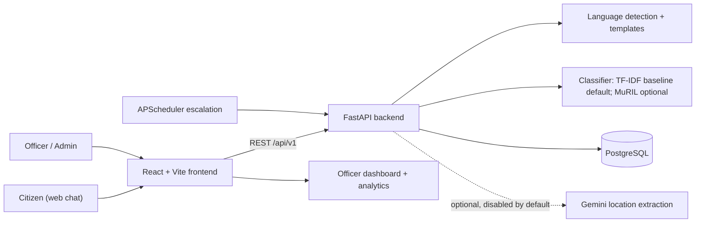

# Neural Storm HI-02: Multilingual Citizen Grievance Chatbot

[](https://github.com/MayankLumbhani/neural-strom-hi02/actions/workflows/ci.yml)

**Problem statement:** HI-02, Multilingual Citizen Grievance Chatbot  
**Event:** Neural Storm 2026  
**Solo participant:** Mayank Lumbhani

## Live demo

- Frontend: [https://neural-strom-hi02.vercel.app](https://neural-strom-hi02.vercel.app)
- Backend API: [https://hi02-grievance-api.onrender.com](https://hi02-grievance-api.onrender.com)

The backend runs on Render's free tier and sleeps after about 15 minutes idle.
The first request can take up to about 50 seconds, so open the frontend a minute
before demoing. Health and readiness are at `/health` and `/ready`; interactive
API docs are at `/docs` if enabled on the deployment.

A citizen types a civic complaint in their own language. The system detects the
language, routes the complaint to the right municipal department, asks for
clarification when it is unsure, creates a trackable ticket, and keeps the
citizen informed. Department officers get a dashboard for their queue, and
overdue tickets escalate automatically.

All data is synthetic. The demo city is the fictional Furfuri Nagar Municipal
Corporation (FMC).

## Problem and approach

Citizens face three practical failures when reporting a civic issue:

1. Portals are mostly English or Hindi, while many people write in Gujarati or
   mix languages ("mere ghar ke bahar paani nahi aa raha").
2. The citizen must choose a department, and wrong choices send complaints to
   the wrong office.
3. After filing, there is little visibility into who is handling the complaint
   or whether anything has changed.

This project removes the form. The citizen sends free text; the system detects
the language, classifies the department, extracts a location, asks a short
follow-up when confidence is low or the location is missing, and returns a
ticket ID. Fixed replies come from per-language templates, never from an LLM.
Officers update tickets; a scheduled job escalates stale ones.

## Architecture



Request flow: router -> service -> repository. Conversation state lives in
PostgreSQL, so the API is stateless. The classifier is used only through a
`Classifier` interface, which keeps the baseline, MuRIL and a test fake
swappable. The classifier is loaded once at startup.

The chat uses a persisted state machine: collect the complaint, ask for the
department when confidence is low, ask for the location when missing, then
create the ticket. The confidence policy is configurable: accept the top
department at `CLASSIFIER_ACCEPT_THRESHOLD` or when its margin over the
runner-up is at least `CLASSIFIER_MARGIN_THRESHOLD` (with a minimum
`CLASSIFIER_MARGIN_MIN_CONFIDENCE`); otherwise ask the citizen to choose from
all localized department buttons. Free-text answers such as `water`, `paani` or
`પાણી` resolve through department names and aliases.

## Features

- Multilingual complaint intake in English, Hindi, Gujarati and Hinglish, with
  seven experimental languages.
- Script-based language detection with Hindi versus Marathi disambiguation and
  a Hinglish heuristic for Latin text.
- Department classification through a swappable `Classifier` interface.
- Clarification flow for low confidence and missing locations.
- Human-friendly ticket IDs such as `FMC-261104-858I`.
- Public ticket status lookup with only public events and notes.
- JWT login for officers and admins, with department-scoped queries.
- Officer dashboard with status, text and date filters plus ticket history.
- Admin analytics: counts by department, status and language, average
  resolution time, and the escalated ticket queue.
- Scheduled SLA escalation with idempotent database updates. `DEMO_MODE`
  shortens SLAs to minutes for the demo.
- Fixed, template-based user-facing messages in every registry language.
- Rate limiting, input length limits, security headers and structured JSON logs
  that exclude complaint text.
- English, Hindi and Gujarati UI with an accessible language switcher.

The optional LLM path is used only for location extraction and offline dataset
generation. It is disabled by default and never writes user-facing replies.

## Language support

| Tier | Languages | Status |
|---|---|---|
| Tier 1 | English (`en`), Hindi (`hi`), Gujarati (`gu`), Hinglish (`hinglish`) | Verified: full synthetic dataset, AI-authored evaluation set, reported metrics |
| Tier 2 | Marathi (`mr`), Bengali (`bn`), Tamil (`ta`), Telugu (`te`), Kannada (`kn`), Malayalam (`ml`), Punjabi (`pa`) | Experimental: smaller LLM-drafted data, machine-translated templates, small unverified evaluation sets |

Tier 2 results are always reported separately and labelled unverified. Urdu,
Odia, Assamese and romanized text other than Hinglish are not supported.

## Tech stack

| Layer | Technology |
|---|---|
| Backend | Python 3.11, FastAPI, SQLModel, PostgreSQL, Alembic, APScheduler |
| ML | scikit-learn TF-IDF + Logistic Regression baseline; optional PyTorch / Hugging Face MuRIL fine-tune |
| Frontend | React, Vite, TypeScript, Tailwind CSS, shadcn/ui, Recharts |
| Tooling | ruff, mypy, pytest, ESLint, pre-commit, Docker, Docker Compose, GitHub Actions |
| Deployment target | Render free tier (Docker backend), Vercel (frontend), Neon (PostgreSQL) |

## Setup and local run

Prerequisites: Python 3.11+, Node.js 20+, Docker Desktop with Compose.

```bash
git clone https://github.com/MayankLumbhani/neural-strom-hi02.git
cd neural-strom-hi02
cp .env.example .env
```

Edit `.env` and set local values for `POSTGRES_PASSWORD`, `JWT_SECRET` and the
`DEMO_*` account variables. Never commit `.env`.

Start the backend and PostgreSQL:

```bash
docker compose up -d --build
curl http://localhost:8000/ready
```

The API container waits for PostgreSQL, applies Alembic migrations, runs the
idempotent seed automatically, then serves. The seed creates the nine synthetic
departments and, when `DEMO_MODE=true` and the `DEMO_*` values are complete,
the demo officer/admin accounts. It is safe to run more than once and can be
rerun manually with `docker compose exec -T api python -m grievance.seed`.
Passwords are never logged. The default baseline classifier is trained once
during the Docker image build and loaded from
`ml/artifacts/baseline.joblib` at startup; the committed synthetic split
`ml/data/processed/train.csv` is the build input and the local fallback. To use
the published MuRIL model instead, set `CLASSIFIER_BACKEND=muril` and
`MODEL_NAME_OR_PATH`.

Start the frontend in another terminal:

```bash
cd frontend
npm ci
cp .env.example .env
# Set VITE_API_BASE_URL=http://localhost:8000
npm run dev
```

**Demo login:** demo credentials are configured through the `DEMO_*`
environment variables at seed time and are not published in this repository.

Run the checks:

```bash
python -m pip install -e ".[dev]"
make lint
make test

cd frontend
npm run lint
npm run build
```

Mutating API endpoints and the escalation job need a running PostgreSQL. The
frontend provides `/` for chat, `/status` for public lookup, `/login` for staff,
`/dashboard` for officers and `/analytics` for administrators.

## Results

Every number below comes from files in `ml/reports/`, `ml/artifacts/`,
`docs/MODEL_CARD.md` or `loadtests/results/`. Tier 1 and Tier 2 are reported
separately.

### Classifier evaluation set

The evaluation set has 170 rows: 100 Tier 1 rows and 70 Tier 2 rows, written by
Claude (an AI), not by humans, and never used for training. Tier 1 rows are
short and parallel, so the Tier 1 accuracy is an optimistic estimate. Tier 2
rows are not verified by native speakers.

### Tier 1 classifier results

The default backend is the TF-IDF + Logistic Regression baseline (D-14). MuRIL
is the optional published backend `MayankLumbhani/hi02-muril-grievance`.

| Tier 1 language | Baseline accuracy | Baseline macro-F1 | MuRIL accuracy | MuRIL macro-F1 |
|---|---:|---:|---:|---:|
| English (`en`) | 0.840 | 0.814 | 0.84 | 0.7873 |
| Gujarati (`gu`) | 0.840 | 0.825 | 0.92 | 0.8571 |
| Hindi (`hi`) | 1.000 | 1.000 | 0.92 | 0.8571 |
| Hinglish (`hinglish`) | 0.840 | 0.848 | 0.88 | 0.8190 |
| **Overall Tier 1** | **0.880** | **0.877** | **0.89** | **0.8306** |

Baseline report: `ml/reports/baseline_metrics.json`. MuRIL report:
`ml/reports/muril_metrics.json` (also in `ml/artifacts/`).

| Tier 1 metric | Baseline | MuRIL |
|---|---:|---:|
| Overall accuracy | 0.88 | 0.89 |
| Macro-F1 | 0.877 | 0.831 |
| HEALTH F1 | 0.571 | 0.0 |

MuRIL is not clearly better on this evaluation set. The baseline is the default
because it is lighter and faster, has substantially better HEALTH F1, and the
accuracy gap is too small to be meaningful on 100 AI-authored rows. The baseline
report predates the D-10 training-label normalization; the MuRIL report is from
a second run on normalized training data. Both use the same evaluation set.

### Chat acceptance calibration

The chat auto-accept rule was tuned on the validation split only, not on this
evaluation set. With `CLASSIFIER_ACCEPT_THRESHOLD=0.35`,
`CLASSIFIER_MARGIN_THRESHOLD=0.12` and
`CLASSIFIER_MARGIN_MIN_CONFIDENCE=0.25`, validation Tier 1 accepted 466 of 720
rows (64.7% coverage) with 416 correct (89.3% precision). The held-out
handwritten Tier 1 evaluation accepted 77 of 100 rows (77.0% coverage), all 77
correct. Because the evaluation set is small and AI-authored, this is an
observed tradeoff, not a general correctness claim. The generated report is
`ml/reports/confidence_calibration.json`; regenerate it with
`make calibrate-baseline`.

### Tier 2 classifier results (experimental, unverified)

Tier 2 rows: 10 per language, AI-authored and not checked by native speakers.

| Tier 2 language (unverified) | Baseline accuracy | Baseline macro-F1 | MuRIL accuracy | MuRIL macro-F1 |
|---|---:|---:|---:|---:|
| Marathi (`mr`) | 0.900 | 0.926 | 0.8 | 0.7778 |
| Bengali (`bn`) | 0.700 | 0.574 | 0.9 | 0.8519 |
| Tamil (`ta`) | 1.000 | 1.000 | 0.9 | 0.8519 |
| Telugu (`te`) | 0.900 | 0.926 | 0.9 | 0.8519 |
| Kannada (`kn`) | 0.900 | 0.867 | 0.9 | 0.9259 |
| Malayalam (`ml`) | 1.000 | 1.000 | 0.9 | 0.8519 |
| Punjabi (`pa`) | 1.000 | 1.000 | 0.9 | 0.8519 |
| **Overall Tier 2 (unverified)** | **0.914** | **0.918** | **0.886** | **0.858** |

These are experimental results, not verified quality claims. Full per-class
numbers and confusion matrices are in the report files and
[`docs/MODEL_CARD.md`](docs/MODEL_CARD.md).

### Load test (local, one instance)

A 60-second, 20-user Locust run against the local Docker Compose stack. Raw CSV
files and the full conditions are in `loadtests/results/`. This was a laptop,
not the deployed environment.

| Metric | Measured |
|---|---:|
| Total requests | 1,678 |
| Throughput | 29.04 requests/second |
| Failure rate | 0 of 1,678 (0.00%) |
| p50 latency | 360 ms |
| p95 latency | 650 ms |

| Endpoint | Requests/s | p50 | p95 |
|---|---:|---:|---:|
| `POST /api/v1/chat/messages` | 21.76 | 410 ms | 680 ms |
| `GET /api/v1/tickets/{public_id}` | 5.30 | 220 ms | 370 ms |
| `GET /health` | 1.99 | 52 ms | 100 ms |

Conditions: local Docker Desktop on an ASUS Vivobook with an Intel Core
i5-13420H, 15.6 GB host RAM, one API container and one PostgreSQL 16 container,
baseline classifier, LLM disabled, rate limits raised for the test run only.
The Locust generator shared the laptop CPU. See
[`docs/SCALING.md`](docs/SCALING.md) for measured-versus-design-only discussion.

## Honest limitations

- The evaluation set is small (170 rows) and AI-authored by Claude, not
  human-written. Tier 1 accuracy is an optimistic estimate.
- MuRIL HEALTH recall is `0.0` on the Tier 1 evaluation set, and MuRIL is not
  clearly better than the baseline. The baseline is the default for that reason.
- Tier 2 results are experimental, rest on 10 unverified rows per language, and
  use machine-translated templates. They are not native-speaker verified.
- Training data is synthetic and LLM-drafted; most rows remain unreviewed.
- The public rate limiter is process-local, so quotas are not shared across
  workers or replicas.
- The escalation scheduler runs inside the API process; the update is
  idempotent, but each replica would run its own scheduler.
- Short or typo-heavy messages can be misrouted. In a live test, a misspelled
  Hinglish electricity complaint was routed to Property Tax and Billing.
- The lowered confidence thresholds from D-17 were tuned on validation data and
  trade precision for coverage, so some accepted complaints are still wrong.
- Render's free tier sleeps after about 15 minutes idle, so the first request
  can take up to about 50 seconds. The UI retries readiness before the first
  chat message.
- The load test was run locally against Docker Compose, not against the live
  Render deployment. The live deployment is provided for the demo and is not
  claimed as verified by the measurements above.

## AI tools used

This project was built with AI assistance:

- Qoder
- Cursor
- Antigravity
- GitHub Copilot
- opencode
- Claude

Claude helped draft code, documentation and the AI-authored evaluation data.
Google Gemini is used through its API only for optional offline synthetic
dataset generation and location extraction. No LLM writes the fixed user-facing
replies.

## Disclosure

Development started on **October 30, 2026**, before the official November 2
hackathon start, with organiser permission.

## Documentation

- [`docs/PRD.md`](docs/PRD.md): problem, users, requirements and demo plan
- [`docs/ARCHITECTURE.md`](docs/ARCHITECTURE.md): layering, data model, API contracts and flows
- [`docs/DECISIONS.md`](docs/DECISIONS.md): technology and design decisions
- [`docs/MODEL_CARD.md`](docs/MODEL_CARD.md): dataset, models, metrics and limitations
- [`docs/API.md`](docs/API.md): every endpoint with examples and curl calls
- [`docs/RUNBOOK.md`](docs/RUNBOOK.md): local run, deployment, secret rotation and troubleshooting
- [`docs/SCALING.md`](docs/SCALING.md): measured load test and design-only scale-out ideas
- [`docs/TASKS.md`](docs/TASKS.md): task checklist and work log

## License

A `LICENSE` file exists in the repository but currently contains no license
text. No license is granted until a license is added.
