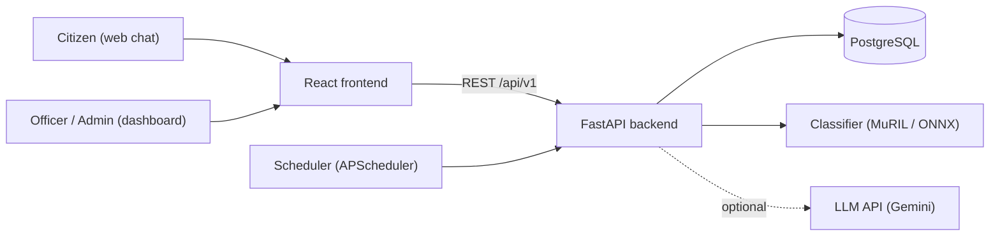
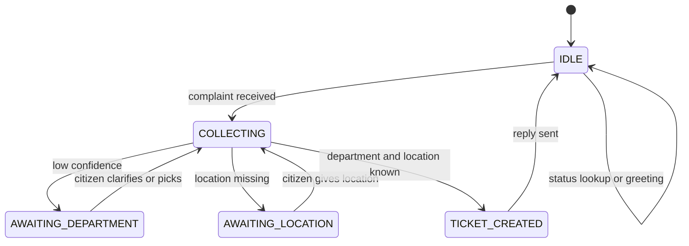
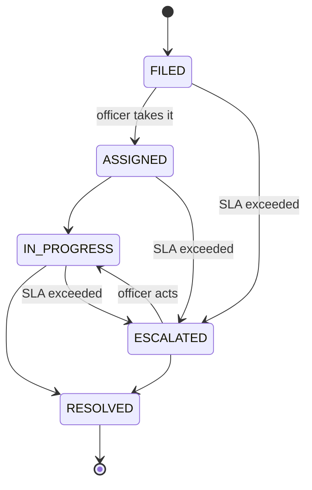
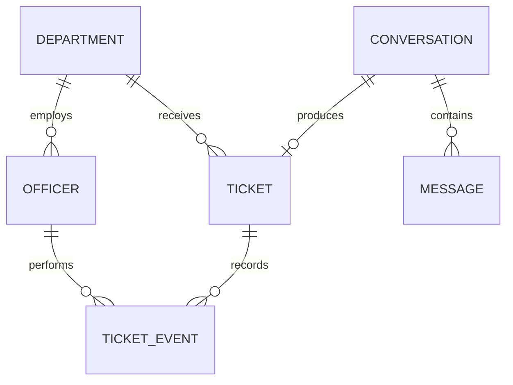

# Architecture (HLD and LLD)

**Project:** neural-storm-hi02, Multilingual Citizen Grievance Chatbot
**Status:** Design stage. Every component below is **Planned** until marked otherwise in section 17. Update that table as work lands.
**Related docs:** `docs/PRD.md`, `docs/DECISIONS.md`, `docs/API.md`, `docs/MODEL_CARD.md`, `docs/SCALING.md`

---

## 1. Goals and constraints

- Stateless, horizontally scalable API.
- Clear layering so AI-generated code stays organized and testable.
- A measurable classifier behind a swappable interface.
- Deterministic user-facing messages (templates), LLM only where it adds value and always with a fallback.
- Fits free-tier hosting for the hackathon: one Docker backend with the model, a static frontend, a hosted Postgres.
- Solo build in a few days, so no unnecessary infrastructure (no Celery, Redis, Kubernetes).

## 2. System context



## 3. Deployment topology

| Piece | Host | Notes |
|---|---|---|
| Frontend | Vercel | Static React build, calls the backend over HTTPS |
| Backend and model | Hugging Face Spaces (Docker, CPU) | Enough RAM for the model. Sleeps when idle, so wake it before judging |
| Database | Neon PostgreSQL | Persistent, free tier |
| Model weights | Hugging Face Hub | Not committed to Git, loaded by name from config |
| Local dev | docker-compose (api and postgres) | `make dev` |

CORS allows only the configured frontend origin.

## 4. Backend layering

```
Request
  -> api/v1 (routers)        validate input, call a service, return a schema
  -> services                business logic, orchestration, transactions
  -> repositories            all database queries
  -> models (SQLModel)       table definitions

services also use:
  -> nlp/                    language registry and detection, Classifier, extraction, templates
  -> core/                   config, logging, security, exceptions
```

Rules (also in `AGENTS.md`):
1. Routers contain no business logic and no queries.
2. Services never import FastAPI.
3. Only repositories touch the database.
4. The classifier is accessed only through the `Classifier` interface.
5. No in-process state that matters across requests.
6. Languages are defined only in the language registry (`nlp/languages.py`).

### Module map

| Package | Responsibility |
|---|---|
| `core/config.py` | pydantic-settings, all env variables |
| `core/logging.py` | structured JSON logs with request ID, no complaint text |
| `core/security.py` | password hashing, JWT creation and verification |
| `core/exceptions.py` | domain errors mapped to HTTP errors |
| `api/v1/chat.py` | `POST /chat/messages` |
| `api/v1/tickets.py` | public status lookup |
| `api/v1/auth.py` | login |
| `api/v1/admin.py` | officer and admin ticket operations and analytics |
| `api/v1/health.py` | `/health`, `/ready` |
| `services/chat_service.py` | conversation state machine and orchestration |
| `services/ticket_service.py` | create ticket, validate transitions, record events |
| `services/escalation_service.py` | find and escalate overdue tickets |
| `services/analytics_service.py` | aggregate counts and resolution times |
| `nlp/languages.py` | language registry: every supported language, its tier, script, font and template file |
| `nlp/language.py` | script detection, Hindi vs Marathi disambiguation and Hinglish heuristic, driven by the registry |
| `nlp/classifier.py` | `Classifier` protocol and implementations |
| `nlp/extraction.py` | location extraction (LLM with rule-based fallback) |
| `nlp/templates/` | one message template file per registry language (Tier 1 written by hand, Tier 2 machine-translated and flagged) |
| `jobs/scheduler.py` | registers the escalation job |

## 5. Conversation design

The API is stateless, so conversation state is stored in the database and loaded by `conversation_id` on each message.



### Message handling steps (`ChatService.handle_message`)

1. Load or create the conversation and store the incoming message.
2. Normalize text (trim, unicode normalization, collapse whitespace).
3. Detect language and script, and set the reply language (remember it on the conversation).
4. If the text matches the ticket ID pattern, return the status reply (read-only).
5. Based on the conversation state:
   - `IDLE`: treat as a new complaint, or a greeting or help message.
   - `AWAITING_DEPARTMENT`: interpret a quick-reply choice, or re-classify using the original complaint plus the new text.
   - `AWAITING_LOCATION`: treat the text as the location.
6. Classify and extract fields not yet known (department, location).
7. Decide the next action (ask for department, ask for location, create ticket).
8. Build the reply from templates, store it, update the state, and return.

### Classification confidence policy

| Condition (initial values, tuned on the validation set) | Action |
|---|---|
| confidence at or above `CLASSIFIER_HIGH_THRESHOLD` (start at 0.75) | Accept the department |
| between the thresholds | Ask to confirm, offering top-2 departments as quick replies |
| below `CLASSIFIER_LOW_THRESHOLD` (start at 0.45) | Ask what the problem is, then offer all departments as quick replies. If it is still unclear, route to OTHER |

Thresholds are environment config. The values above are starting points, not results.

## 6. NLP pipeline

### 6.1 Language registry and detection

All supported languages live in one registry, `nlp/languages.py`. Each entry holds: code, English name, native name, script, tier (1 or 2), font family, template file and a `verified` flag. Adding a language means a registry entry, a template file, tests and docs, with no changes to business logic. A Tier 2 language can be switched off by disabling it in the registry.

| Tier | Languages |
|---|---|
| 1, verified | English (en), Hindi (hi), Gujarati (gu), Hinglish (hinglish) |
| 2, experimental | Marathi (mr), Bengali (bn), Tamil (ta), Telugu (te), Kannada (kn), Malayalam (ml), Punjabi (pa) |

Detection steps:
1. Count characters per Unicode block and pick the dominant script:

| Script | Unicode block | Language |
|---|---|---|
| Devanagari | U+0900 to U+097F | Hindi or Marathi (step 2) |
| Bengali | U+0980 to U+09FF | bn |
| Gurmukhi | U+0A00 to U+0A7F | pa |
| Gujarati | U+0A80 to U+0AFF | gu |
| Tamil | U+0B80 to U+0BFF | ta |
| Telugu | U+0C00 to U+0C7F | te |
| Kannada | U+0C80 to U+0CFF | kn |
| Malayalam | U+0D00 to U+0D7F | ml |
| Latin | basic Latin letters | en or hinglish (step 3) |

2. Devanagari is shared by Hindi and Marathi. Count marker words for each language (the exact method is recorded in `docs/DECISIONS.md`). If the counts tie or there is no signal, use Hindi.
3. For Latin script, a heuristic checks for common romanized Hindi words (for example "nahi", "paani", "mere", "hai", "raha") and decides Hinglish vs English.
4. If the script is unknown or unsupported (for example Arabic script), the reply is in English and Hindi.

Detection chooses the reply language only. Classification does not depend on it, because the classifier reads the text directly. Before a Tier 2 language is enabled, check that the base model covers it (see the MuRIL model card) and that its templates exist.

### 6.2 Classifier

```python
class Classifier(Protocol):
    def predict(self, text: str) -> Prediction: ...

class Prediction(BaseModel):
    label: DepartmentCode
    confidence: float
    top_k: list[tuple[DepartmentCode, float]]
```

Implementations:
- `MurilClassifier`: fine-tuned `google/muril-base-cased`, 9 classes, softmax confidence. MuRIL was pretrained on transliterated as well as native-script Indian text, which helps with Hinglish. This is validated by per-language metrics, not assumed.
- `BaselineClassifier`: TF-IDF (character n-grams) plus Logistic Regression, used for comparison and as a fallback.
- `OnnxClassifier` (optional): the quantized export of the MuRIL model for faster CPU inference. Latency gain is measured, not assumed.

The active implementation is chosen by `CLASSIFIER_BACKEND`. The model is loaded once at startup and reused.

### 6.3 Extraction
- Goal: pull a free-text location (area, landmark, ward, street) from the complaint.
- Primary: LLM call with a strict JSON schema, short timeout and low token limit.
- Fallback: rule-based patterns (words such as "near", "ward", "society", "road", "nagar", and their Hindi and Gujarati equivalents). Tier 2 languages have no rule-based patterns, so they rely on the LLM path or ask the citizen for the location. If the fallback also fails, ask the citizen.
- The LLM never writes user-facing replies and never decides the department. The classifier does.

### 6.4 Templates
Each language file has the same keys, for example `ticket_created`, `ask_location`, `ask_department`, `status_reply`, `status_labels.*`, `not_found`, `help`, `error_generic`. There is one template file per registry language. A test asserts that every language file has identical keys. Tier 2 files are machine-translated and carry a header comment saying so.

## 7. Ticket lifecycle



- A ticket is created in `FILED` and sits in its department's queue.
- `ESCALATED` is set only by the system. It is a visible flag for admins.
- Every transition creates a `ticket_events` row.
- Invalid transitions raise a domain error that maps to HTTP 409.

### Escalation
- APScheduler runs `EscalationService.run()` every `ESCALATION_INTERVAL_SECONDS`.
- It selects tickets not in `RESOLVED` or `ESCALATED` whose `status_changed_at` is older than the department SLA, marks them `ESCALATED`, increments `escalation_level` and records an event.
- The job must be idempotent, because with several replicas more than one instance could run it. Use a single `UPDATE ... WHERE` statement (or `SELECT ... FOR UPDATE SKIP LOCKED`) so a ticket is escalated only once.
- `DEMO_MODE=true` uses minutes instead of hours for SLA windows.

## 8. Data model



| Table | Key columns |
|---|---|
| `departments` | `id`, `code` (unique), `name_en`, `name_hi`, `name_gu`, `sla_hours` |
| `officers` | `id`, `username` (unique), `password_hash`, `role` (`DEPARTMENT_OFFICER` or `ADMIN`), `department_id` (nullable for admins), `is_active` |
| `conversations` | `id` (UUID), `state`, `language`, `pending_text`, `pending_department`, `pending_location`, `created_at`, `updated_at` |
| `messages` | `id`, `conversation_id`, `sender` (`citizen` or `bot`), `text`, `language`, `created_at` |
| `tickets` | `id`, `public_id` (unique, for example `FMC-261030-7K3F`), `conversation_id`, `department_id`, `complaint_text`, `language`, `location_text`, `contact_phone` (nullable), `status`, `status_changed_at`, `escalation_level`, `predicted_confidence`, `created_at`, `resolved_at` |
| `ticket_events` | `id`, `ticket_id`, `from_status`, `to_status`, `actor_type` (`system`, `officer`, `citizen`), `officer_id` (nullable), `note`, `is_public`, `created_at` |

Indexes: `tickets(public_id)`, `tickets(department_id, status)`, `tickets(status, status_changed_at)` for the escalation query, `messages(conversation_id, created_at)`.

Notes:
- `public_id` format: `FMC-<yymmdd>-<4 random chars>`, generated with a retry on collision. It is hard to guess but short enough to type.
- Every `language` column stores a language registry code (for example `gu`, `hinglish`, `ta`).
- Complaint text is stored in the database (needed to work the ticket) but is never written to application logs.
- All data is synthetic in this project.

## 9. API contracts

Base path `/api/v1`. Full request and response examples live in `docs/API.md`.

### Public
| Method and path | Purpose | Request | Response |
|---|---|---|---|
| `POST /chat/messages` | Send a citizen message | `{ conversation_id?, text }` | `{ conversation_id, state, language, reply: { text, quick_replies[] }, ticket? }` |
| `GET /tickets/{public_id}` | Public status lookup | none | `{ public_id, status, department, location, created_at, updated_at, public_events[] }` |
| `GET /health` | Liveness | none | `{ status: "ok" }` |
| `GET /ready` | Readiness (database and model) | none | `{ status: "ready", db: "ok", model: "loaded" }` |

### Auth
| Method and path | Purpose | Request | Response |
|---|---|---|---|
| `POST /auth/login` | Officer or admin login | `{ username, password }` | `{ access_token, token_type, role, department }` |

### Officer and admin (Bearer token required)
| Method and path | Purpose |
|---|---|
| `GET /admin/tickets` | List tickets with filters (`status`, `department`, `q`, `page`, `page_size`). Officers are restricted to their department. |
| `GET /admin/tickets/{public_id}` | Ticket detail with full event history |
| `PATCH /admin/tickets/{public_id}/status` | Body `{ status, note?, is_public? }`. Validates the transition and writes an event. |
| `GET /admin/analytics/summary` | Counts by department, status, language, and average resolution time |
| `GET /admin/departments` | Department list |

### Error format
```json
{ "error": { "code": "INVALID_TRANSITION", "message": "...", "details": {} }, "request_id": "..." }
```
Status codes: 400 validation, 401 unauthenticated, 403 forbidden, 404 not found, 409 invalid state change, 422 schema error, 429 rate limited, 500 unexpected.

## 10. Security and privacy

- Passwords hashed with bcrypt or argon2. JWTs signed with `JWT_SECRET`, short expiry.
- Role check dependency on every `/admin` route. Officers are filtered by `department_id` in the repository layer, not only in the router.
- Rate limiting on `/chat/messages` and `/tickets/{id}` per IP (for example with `slowapi`).
- Input length limits, Pydantic validation everywhere.
- Secrets only from environment. `.env` is git-ignored. `.env.example` documents each variable.
- Logs include request ID, route, status and latency. They exclude complaint text and phone numbers.
- Public status lookup returns only public fields.
- Known demo limitation: anyone who has a ticket ID can view its public status. Real deployments would add a phone verification step.

## 11. Configuration (environment variables)

| Variable | Purpose |
|---|---|
| `APP_ENV`, `LOG_LEVEL`, `DEMO_MODE` | Runtime mode |
| `DATABASE_URL` | Postgres connection string |
| `JWT_SECRET`, `JWT_EXPIRE_MINUTES` | Auth |
| `CORS_ORIGINS` | Allowed frontend origins |
| `CLASSIFIER_BACKEND` | `muril`, `onnx` or `baseline` |
| `MODEL_NAME_OR_PATH`, `HF_TOKEN` | Where to load weights from |
| `CLASSIFIER_HIGH_THRESHOLD`, `CLASSIFIER_LOW_THRESHOLD` | Confidence policy |
| `LLM_ENABLED`, `GEMINI_API_KEY`, `LLM_TIMEOUT_SECONDS` | Optional extraction helper |
| `ESCALATION_INTERVAL_SECONDS` | Scheduler cadence |
| `RATE_LIMIT_CHAT`, `RATE_LIMIT_STATUS` | Rate limits |
| `MAX_MESSAGE_LENGTH` | Input cap |

## 12. Frontend structure

```
frontend/src/
  features/
    chat/          chat window, message list, quick replies, language-aware input
    tickets/       public status page
    dashboard/     officer ticket table, ticket detail drawer, admin analytics
    auth/          login form, token handling
  components/ui/   shadcn components
  lib/             typed API client, i18n (UI strings), config
  pages/           routes: /, /status, /login, /dashboard
```

- Typed API client generated from or aligned to the OpenAPI schema.
- UI strings go through i18n (English, Hindi, Gujarati). The chat itself works in every registry language, and users of Tier 2 languages see the English UI.
- Chat shows a "waking up the server" message if the first request is slow.
- Noto Sans fonts for every registry script (Gujarati, Devanagari, Bengali, Gurmukhi, Tamil, Telugu, Kannada, Malayalam) are loaded explicitly, and the Tier 2 fonts are loaded on demand so the first page stays light.

## 13. ML pipeline (offline)

1. `ml/src/generate_dataset.py`: build a synthetic complaints dataset with an LLM, covering the 9 departments across all registry languages (full size for Tier 1, smaller for Tier 2), with variations (typos, slang, code-mixing, missing location, ambiguity). Manually review a sample.
2. `ml/data/eval_handwritten/`: about 100 to 150 messages written by hand for the Tier 1 languages, plus about 20 per Tier 2 language drafted with LLM help and marked `verified=false`. Never used for training.
3. `ml/src/train_baseline.py`: TF-IDF plus Logistic Regression.
4. `ml/src/train_muril.py` (run in Colab or Kaggle): fine-tune MuRIL, save the model to the Hugging Face Hub.
5. `ml/src/evaluate.py`: accuracy, per-class precision, recall and F1, macro-F1, per-language breakdown (with the tier shown, Tier 1 and Tier 2 in separate tables) and confusion matrix for both models on the evaluation set. Writes `ml/reports/metrics.json` and images.
6. `ml/src/export_onnx.py` (optional): export and quantize, then compare latency and accuracy against PyTorch.

All numbers in the README and model card come from these reports.

## 14. Scalability design

Full detail in `docs/SCALING.md`. In short:

- **Now:** stateless API, async FastAPI, pooled DB connections, model loaded once, optional ONNX quantization, per-IP rate limiting, health and readiness checks, idempotent escalation job. A load test measures one-instance throughput and p95 latency.
- **Scale-out path (design only):**
  1. Split inference into its own service so it scales separately.
  2. Add a queue between complaint intake and classification, so spikes never drop complaints (the citizen gets an immediate "received" ticket ID while classification completes).
  3. Autoscale API replicas behind a load balancer, add Postgres read replicas and partition tickets by region or date.
  4. Add metrics, tracing and alerting.
- The main bottleneck is model inference, not the database or ticket logic. This is why the interface boundary around `Classifier` matters.

## 15. Observability

- Structured JSON logs with request ID, route, status code, latency and, for chat, classifier label and confidence (no text).
- `/health` and `/ready` for orchestrators.
- Metrics endpoint and dashboards are a documented future step, not part of the hackathon build.

## 16. Testing strategy

| Level | What |
|---|---|
| Unit | Language detection, template key parity across languages, confidence policy, status transition rules, ticket ID generation, escalation selection logic |
| Integration | Chat flow end to end (happy path, missing location, ambiguous, status lookup) with a stub classifier, auth and role restrictions, escalation job against a test database |
| ML | Evaluation script runs on the hand-written set and writes reports |
| Load | k6 or Locust script against `/chat/messages` and `/tickets/{id}` |
| CI | ruff, mypy, pytest on every push |

Chat integration tests use a deterministic fake `Classifier` so they do not depend on model weights.

## 17. Implementation status

| Component | Status |
|---|---|
| Repo, docs, AGENTS.md | Done |
| Backend scaffold | Done |
| Health endpoints and CI | Planned |
| Database models and migrations | Planned |
| Language registry, detection and Tier 1 templates | Planned |
| Tier 2 languages (templates, data, evaluation) | Planned |
| Dataset and baseline classifier | Planned |
| MuRIL fine-tune and evaluation | Planned |
| Chat service and clarification flow | Planned |
| Ticket service and status API | Planned |
| Auth and officer endpoints | Planned |
| Escalation job | Planned |
| Frontend chat | Planned |
| Frontend dashboard and analytics | Planned |
| Deployment (HF Spaces, Vercel, Neon) | Planned |
| Load test and SCALING.md | Planned |
| README with metrics and screenshots | Planned |
| Voice input (stretch) | Not started |

## 18. Key decisions and trade-offs

Detailed entries go in `docs/DECISIONS.md`. Initial ones:

| Decision | Chosen | Alternatives | Reason |
|---|---|---|---|
| Classifier | Fine-tuned MuRIL | Zero-shot LLM only, IndicBERT | Measurable, cheap at inference, handles Indian languages and transliteration well |
| Fixed replies | Templates | LLM-generated replies | Deterministic, reviewable, free, and safe |
| Background work | APScheduler in the API process | Celery plus Redis | Far less infrastructure, enough for the demo, idempotent so safe with replicas |
| Database | PostgreSQL | SQLite | Persistent on free hosts, supports concurrency and `SKIP LOCKED` |
| Conversation state | In the database | In memory | Keeps the API stateless and horizontally scalable |
| Hosting the model | Hugging Face Spaces | Render free tier | More RAM for the model |
| Orchestration framework | Plain services | Rasa, LangChain | Simpler, easier for AI IDEs to keep clean, easier to test |
| Language support | Two tiers behind one registry | Only 3 or 4 languages, or all languages claimed as equal | Wider reach for the core problem without overclaiming what cannot be verified |